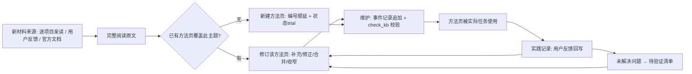

# 建设蓝图 · 历史档案（2026-10-28 初版宪法 → 2026-11-04 修订层）

> 2026-11-05（E240）自知识库建设蓝图.md 整体外迁。逐字保留，不作现行依据；现行宪法见 [../知识库建设蓝图.md](../知识库建设蓝图.md)（其中第五节=现行铁令，即本档铁令原位置的上移版）。

---

# ⛔ 历史档案（2026-10-28 初版宪法与历次修订——仅存档，不作现行依据）

> 以下为 2026-10-28 初版全文与 11-03/11-04 修订层，一字未改。其中"铁令追加"节已上移为现行第五节；作废宣告描述的是更早的深读笔记系。

> 定稿：2026-10-28。本文件是知识库的宪法——结构与流程变更先改这里。
> 模式范本：`D:\seedance2.5提示词及结构`（只读参考）。

## 一、目录结构（定稿 · ⚠️ 以下目录树为旧架构，已作废，现行见 README.md）

```
06_知识库\
├── AGENTS.md                  ← AI 协作约定（AI 进库先读）
├── README.md                  ← 人读入口：按任务查 / 按问题查 / 按模型查
├── 知识库建设蓝图.md           ← 本文件（宪法）
├── index.json                 ← 机器可读目录（方法页元数据，由维护脚本生成）
├── 现行知识\                   ← 【唯一维护正文】只放提炼后的方法页
│   ├── 索引.md                ← 方法页索引（ID/状态/更新日期）
│   ├── K01-提示词结构总纲.md
│   └── K02+…                  ← 按需生长，编号顺延
├── 研究记录\                   ← 【追溯依据】深读笔记/过程分析，不是现行规则
│   ├── 深读笔记_主线程.md      ← 逐项目亲读原始笔记
│   ├── 02-逐条深读笔记索引.md  ← （从现行知识迁入）
│   ├── 阅读材料\              ← 78 项目去重提示词导出（309MB）
│   └── 逐条摘要\              ← 78 项目逐条摘要（7.7MB）
├── 实践记录\                   ← 【用户反馈】实际使用后的回写（空置待用）
│   └── 任务索引.md
├── 维护\
│   ├── 事件记录.md            ← 只追加的变更日志
│   ├── check_kb.js            ← 校验脚本（结构/链接/数字溯源）
│   ├── 全量结构统计.js 等      ← 实测工具（可复跑）
│   └── 全量结构统计_2026-10-27.json ← 实测原始数据
└── 资料库指针.md               ← 78 项目 → 02区/学习仓 的引用登记（不复制数据）
```

## 二、四层职责与铁律

| 层 | 职责 | 铁律 |
|---|---|---|
| **资料库**（02区/学习仓/05区，不在本库内） | 原材料：78 项目 95,298 件资产、brief、skill | 原件不改写；知识库只引用不复制 |
| **现行知识** | 唯一维护正文：提炼后的方法页 | 只收"读者能模仿"的方法；**深读笔记禁止进这层**；每页带状态头 |
| **研究记录** | 追溯依据：亲读笔记/逐条摘要/过程分析 | 笔记不是规则；结论被提炼进方法页后，笔记保留作依据 |
| **实践记录** | 用户实际使用的反馈回写 | 成功失败都记；反馈触发方法页修订 |

## 三、生长流程图



**防错三原则**（从范本学）：
1. **结论分层标记**：方法页里每条结论标注来源类型——`[官方原文]` / `[实测统计]` / `[单案例]` / `[用户经验]`，不得混写
2. **数字必须有出处**：统计数字注明实测脚本与日期；引用注明项目与源链接
3. **笔记与规则分离**：研究记录的发现必须"提炼"后才能进现行知识（提炼 = 重写为读者能模仿的方法，附依据链接）

## 四、方法页格式规范

```markdown
# KXX · 方法页标题

> **状态**：trial（首次建立）→ validated（多项目印证+用户确认）→ deprecated（被替代）
> **更新**：日期 ｜ **复审到期**：日期（方法页 180 日）
> **依据项目**：带链接列表

## 正文（结论 + 依据 + 适用条件 + 例外）
…每条结论标 [实测]/[官方]/[案例]…

## 待验证（生长点）
- [ ] …
```

## 五、防错机制（维护脚本职责）

`维护/check_kb.js` 校验：
1. 每个方法页有状态头（状态/更新/复审/依据）
2. 现行知识目录与 索引.md / index.json 三方一致
3. 方法页里的统计数字标注了出处（正则查 `[实测` / `[官方` 等标记）
4. 事件记录有新条目（每次变更后）
5. 研究记录与现行知识的分离（现行知识里不出现"深读笔记"字样的正文依赖）

## 六、复审机制

- 方法页默认 **180 日复审**；触发条件（新项目入库 / 用户失败反馈 / 站点改版）提前复审
- 复审 = 核对方法页结论是否被新资料推翻；过期不自动代表错误

## 七、逐项目深读的标准化流程（每轮一个项目）

1. Read `研究记录/阅读材料/<项目>.txt`（分批读完视频部分全文；图像部分抽样对照）
2. 边读边记录：段结构 / 句式 / 独家技巧 / 与已读项目的异同
3. 笔记追加至 `研究记录/深读笔记_主线程.md`
4. 若发现**跨项目成立的方法** → 提炼进对应方法页（K01 或新建）→ 事件记录追加
5. 跑 check_kb.js 确认知识库一致
6. 报告进度，等下一轮

## 八、当前缺口与补齐顺序

| # | 缺口 | 状态 |
|---|---|---|
| 1 | 02-逐条深读笔记 迁移到研究记录 | 本轮执行 |
| 2 | 现行知识/索引.md 建立 | 本轮执行 |
| 3 | index.json 生成 | 本轮执行 |
| 4 | check_kb.js 写入 | 本轮执行 |
| 5 | 资料库指针.md 登记 78 项目 | 本轮执行 |
| 6 | 深读推进：剩 71 项目 | 持续（每轮一个） |
| 7 | 47 个批次3 brief 后补 | 等浏览器通道 |


---

## 现状更新（2026-11-03，E126-E131）

本蓝图定稿于 10-28（K01-K08 单列时代）。11-03 起实施**双轨制**：

- 目录：现行知识/ 分 **视频轨/**（K01-K05）、**生图轨/**（K06/K09）、**通用/**（K07/K08）+ 独立双入口（按任务查/按问题查）
- 新页：**K09 生图提示词方法（Plate Master 体系）**——生图与视频并重
- 流程层五件套：工作流程 / 来源登记（Sxx 编号制）/ 待验证问题 / 验证报告 / 全量收割计划
- 主线变更：78 深读收官后，主线为**全量项目收割**（T1 官方→T2 高赞→T3 中赞→T4 复查），单项目六步 SOP
- 范本：seedance2.5 + 人物场景图skill 两知识库（用户 11-03 提供）
- 详表见 维护/全量收割计划.md 与 事件记录 E126-E131


---

## ⚠️ 作废宣告（2026-11-04，E143 覆盖）

本蓝图描述的 K01-K08 单轨架构与深读笔记体系已按用户 2026-11-04 铁令**全面作废**（见 _legacy_作废_深读笔记系_2026-11-04/作废说明.md）。现行架构=双轨制（重组期，生图轨 3 页有效）+ 原文优先铁律。本文件仅存历史设计参考，**现行流程以 AGENTS.md 与 维护/工作流程.md 为准**。

---