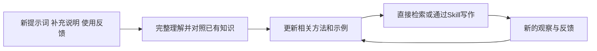

# Seedance 2.5 提示词知识库

这里积累我们目前会用、能借鉴的提示词写法。新提示词、你的解释和使用反馈不断带来更具体的方法、示例与修订。当前版本：**0.1.2 现行版**。

| 想做什么 | 从这里读 |
|---|---|
| 先看通用写法与示例 | [通用结构](现行知识/02-通用结构与选用.md) |
| 按当前任务找方法 | [按任务查](现行知识/按任务查.md)、[按问题查](现行知识/按问题查.md) |
| 浏览所有现行知识 | [知识索引](现行知识/索引.md)、[Agent入口](index.md) |
| 追溯完整原文与研究 | [来源档案](资料库/索引.md)、[来源登记](资料库/来源登记.md) |
| 用Skill编写、修改提示词 | [seedance-prompt](skills/seedance-prompt/SKILL.md) |
| 接着学习和完善 | [工作流程](维护/工作流程.md)、[最近更新](维护/更新记录.md) |

## 通用骨架

**生成目标或一句话概述 → 参考分工与必要全局设定 → 按镜头或阶段组织的综合小段 → 结束状态与必要约束。**

每个小段把当时的人物目的、动作、表演、摄影、环境光声联系起来。具体写到什么程度，取决于这段要让观众看见什么。方法页里的短摘录展示怎样落笔，旁边的解释说明为什么这样组织；写作时迁移关系与笔法，沿用当前任务的角色和事件。

“强调！”用于当前重要的身份、特征、场景或指定画面。首帧匹配、音乐、时长、画幅、风格和一镜到底按任务选择。

## 知识怎样生长

日常查询和写稿，读需要的页面就开始。收到一批新材料，完整理解后更新相关正文与示例；一批整理结束时再合并记录、生成索引和Skill参考、检查链接。维护工具保留使用，不继续为普通内容变化扩建防护或测试。

## 来源、知识与写作

来源层保存完整提示词原文与官方资料文字；研究记录保留分析过程；现行知识提供现在可用的方法和示例。三者都同步到本私有仓库，各有用途。完整材料按需追溯，写稿优先读现行知识及其短例。

现行知识是正文主源。Skill参考保留方法、示例和出处，维护状态留在维护记录；在本库中写作可直接查最新方法。Skill源码已可读取使用，尚未安装为自动发现技能。

维护说明集中在[维护约定](维护/Lint与复审.md)。

本批P020长图只同步完整提示词转录，原图留在本地；含媒体访问参数的官方快照以去敏副本进入仓库，正文内容保留。
