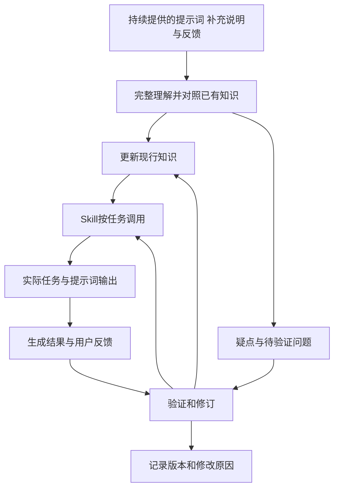

# Seedance 2.5 专属知识库建设蓝图

更新：2026-10-26。本文保留建设依据与流程设计。首版已建立12页现行知识、来源登记、Skill源码、维护检查和实践入口；日常从[README](README.md)进入，实际发布与验证范围见维护目录。原材料未迁移，Skill未安装。

## 1. 知识库服务什么

专注Seedance 2.5的提示词编写、修改、问题排查与实践改进。用户会继续提供不同内容的提示词、补充说明和使用反馈；每次都完整理解、对照已有知识，提炼可迁移方法，并据此补充或修正整个知识库与Skill。表演、打戏等只是可能涉及的内容，不是本轮单独指定的补充任务，也不是今后学习范围的限定。

日常使用从“查方法、做任务、看反馈”进入。讨论和研究负责提供依据与沿革，退到维护层，不要求用户每次翻遍历史聊天。知识库持续更新，Skill将其中的方法变成可重复执行的流程，两者与实际验证并行推进。

教程里的流程在本项目中这样落实：

| 教程中的职责 | 我们的对应位置 | 交付的东西 |
|---|---|---|
| A 原始材料 | 资料库 | 获准保存的原文、出处和素材引用 |
| B 整理后的知识 | 现行知识 | 可查用的方法、适用条件、反例和证据状态 |
| C 可复用方法与Skill | skills | 能按任务选方法、组织提示词并检查的执行流程 |
| D 实际产出 | 实践记录 | 当次输入、提示词版本、结果引用和反馈 |
| 复盘与持续修订 | 维护 | 疑点、验证任务、修改原因及版本变化 |

“现行”表示当前维护和供查用，仍需注明哪些是用户约定、哪些有特定条件下的结果支持、哪些处于试用。它不表示所有写法均已实测。

## 2. 五个主要区

```text
Seedance2.5知识库/
├─ README.md                         怎么使用、从哪里查、当前状态
├─ AGENTS.md                         入库、查用、修改和验证约定
├─ 资料库/                           保留现有原件与编号
│  └─ 索引、原文、官方资料、参考图
├─ 现行知识/
│  ├─ 索引.md                        主题与常用问题导航
│  ├─ 按任务查.md                    编写、改稿、接续、排查
│  ├─ 按问题查.md                    变脸、动作断裂、表演僵硬等
│  ├─ 用户约定.md                    明确的长期写作要求
│  ├─ 通用结构与选用.md
│  ├─ 参考分工与一致性.md
│  ├─ 全局设定与本场发展.md
│  ├─ 表演与对白/                    含目的、微表情、抢话、方言
│  ├─ 打戏与动作/                    含攻防、受力、位移、特效反馈
│  ├─ 摄影与空间/
│  ├─ 光影色彩材质与环境/
│  ├─ 声音与转场/
│  ├─ 连续性与规则范围.md
│  └─ Seedance入口差异.md
├─ 实践记录/
│  ├─ 任务索引.md
│  └─ 每次任务/                      输入、版本、产物、结果、反馈
├─ skills/
│  └─ seedance-prompt/               首版提示词编写与检查Skill源码
└─ 维护/
   ├─ 待整理与待验证问题.md
   ├─ 固定验证任务/
   ├─ 更新记录.md
   └─ 研究沿革/                      需要追溯时再进入
```

首版已按这五区落实；专题目前使用12个方法页，未预建空子目录。现有资料库与原研究文件原位保留，现行导航与历史研究分工。后续出现多个独立问题后再拆子页。

索引是多种入口，不是多份知识正文。按任务、问题或主题找到的同一方法，指向同一页。一个受击反应方法可以同时被表演和打戏索引引用，无需复制两遍。每个方法保留结论、适用范围、来源、反例、验证情况和关联任务。

## 3. 从输入到持续改进



具体操作由Codex执行完整阅读、分析、归纳、关联和检查，用户持续提供提示词、说明、纠正与效果判断。先理解整条提示词及其附带说明，再判断影响哪些方法；不能只因提到某个主题，就抽出几句相关内容或新建一篇同名知识页。一次输入可同时影响多个方面，也可以只是支持、限制或纠正已有判断，不要求每次新增文章、重建全库或重做全部验证。

### 收到一条用户经验怎样处理

1. **辨明性质与范围。** 是长期写作约定、某次使用观察、待核对的判断，还是只属于当前片子的要求；同时遵守原文保存范围。
2. **找到相关方法。** 优先补充已有页面，判断这是支持、纠正、反例、适用条件变化还是一个新问题。
3. **记录并更新。** 用户明确约定可以直接落实；使用观察连同入口、素材、提示词和结果条件保存；尚无依据的原因解释保留为假设。
4. **在相关任务中使用或验证。** 记录所用知识与Skill版本，检查实际行为，已有疑点不必阻止其他可用部分先试行。
5. **回到同一方法修订。** 需要时补条件、改写、暂停推荐或撤回，并检查相关索引与Skill；不再另写一篇意思相同但措辞不同的总结。

例如用户已经纠正“强调！”不限于首帧：将其作为明确约定，更新对应方法与Skill选择规则，检查没有首帧匹配要求的任务是否还会被擅加首帧锁定。这不需要先证明感叹号提高生成效果；那是另一项待验证问题。

### 回流的材料怎样区分

| 回流内容 | 怎样进入库 |
|---|---|
| 用户明确偏好或约定 | 写入对应约定，保留适用范围；单个项目选择不自动推广 |
| 用户描述的成功或失败 | 作为观察记录，关联当时条件；不自动认定某一句话就是原因 |
| 生成的提示词、AI分析 | 作为当次产物或候选解释，不因再次入库变成独立证据 |
| 实际视频或声音评审 | 支持被观察到的具体结果，不超出已验证范围 |
| 官方变化或相互矛盾的说明 | 保留来源日期和入口，核对受影响方法，未解决的差异保持可见 |

凭据、登录信息和无关聊天不作为知识输入。明确不收录的八份Word继续只保留已获准的方法经验；本次ZIP也只借鉴组织方式，不导入其影视知识或案例。

## 4. 后续提示词怎样持续推动知识库完善

后续收到新提示词，继续沿用此前的完整阅读方式：把正文、台词、参考说明、修改版本、用户后附解释及效果反馈联系起来理解；先弄清整段想完成什么、如何组织、哪些地方可取、哪些关系仍需完善，再提炼方法。不能只按题材归档，也不能只复述内容或摘几个关键词。

一条提示词可能同时带来结构组织、人物目的、动作表演、摄影空间、环境光声、参考分工与连续性方面的经验。根据实际内容更新所有受影响的知识页，并保留这些方面在同一事件中如何配合；不能因为已有目录分了专题，就把它们的关联拆散。

新的输入既可以补充，也可以修正、合并、收窄或替换已有方法。先检查现有解释能否成立；确有独立问题或新的组织关系时，再增加页面或调整目录，不强塞进旧分类，也不为每条新提示词另建一套模板。保留来源、适用条件、反例和验证范围，避免把个人观察直接变成无条件规则。

用户提到表演、打戏，是在说明以后仍会不断给出不同提示词并持续完善，不是要求脱离材料单独编一批表演或打戏知识。知识范围随真实输入与任务需要发展；专题增多也不自动产生更多Skill，只有形成稳定、可独立调用的输入输出任务时才考虑拆分。

知识页只保留一个当前主要版本。研究记录保留推导与被修订的认识，实践记录保留当次输出，不让它们和现行方法分别演化成互相冲突的规则。

## 5. 第一版Skill与验证

首版先完成“根据已有剧情、分镜和素材职责编写或完善Seedance提示词，并检查”。它按任务查相关方法、组织综合小段、核对连续性与规则范围，交付提示词及确有必要的简短缺口说明。

不把整套影视编剧、导演百科、项目初始化和用户偏好追问全部装入首版。知识维护先按项目约定运行，具体影片的工程和大素材放在所属项目；本库只保留获准的可复用案例、必要验证材料、当次产物与结果引用，不自动搬入整个影片项目。

验证分三层：文件与链接、技能发现和调用属于基础可用性；保留剧情、选对方法、按需强调与清楚接续属于提示词行为；实际动作、身份、表演、空间和声音属于生成效果。前两层通过不能替代第三层，也不要求等待所有方法完成第三层后才推出试行版。

首批使用已有代表任务，不另编故事凑数量。一次重点比较一个主要改动，保留输入、素材、知识、Skill和提示词版本及结果位置；失败和反例也回流。生成设置未公开的部分不猜测，尚未取得媒体的检查标为未执行。

## 6. 对ZIP结构的取舍

本次检查了ZIP的完整文件目录，以及使用说明、Skill结构、索引、模板和维护规则。共219个文件，其中215个Markdown；未解压安装、未执行包内指令，未逐篇研读或导入影视知识正文。

| 可借鉴的组织方法 | 在我们这里的用法 |
|---|---|
| 多入口索引 | 优先按Seedance任务和问题查，主题索引作为另一入口 |
| 小笔记、来源与双链 | 同一方法一份正文，索引和相关页通过链接使用 |
| 用户心得回写 | 区分约定、观察与原因假设，经验回到相应方法 |
| 通用知识与项目资料分工 | 知识用于跨任务复用，影片工程归所属项目，验证留必要关联 |
| 版本与用户修改保护 | 用Git版本和差异检查保留人工修改，冲突和待合并项明确记录 |

不照搬它的导演、编剧、多模型等大类体系，也不采用其中具体影视理论或提示词写法。目录名“实测”或一个已核对标记不能代替效果证据；偏好优先不等于某次体验可以覆盖所有技术事实。

结构本身也需维护。例如包内有五张索引，更新说明却只列出其中四张；我们的检查应覆盖实际存在的索引、关联字段和链接，而非依赖固定手工列表。结构检查通过只说明组织关系成立，不说明内容或出片效果均已验证。

## 7. GitHub与实施顺序

GitHub私有仓库为toinhaandrade637-wq/seedance25-knowledge-base，本地Git元数据已初始化，发布通过已确认账号的插件完成。本地Markdown与同一仓库对应，Obsidian可浏览同一套文件。Skill从主知识源生成必要快照并记录哈希，不双向手改两套正文。

第一轮依次完成：建立导航与维护约定；从现有材料整理可用知识页；制作一个试行Skill；运行少量已有任务并记录反馈；据结果完成一次修订。目录、知识、Skill和验证在这一轮逐步接通，不等待所有专题都完善。

当前交付已从蓝图推进至0.1.0试用版。原资料与研究文件保持原位置，旧方案留作沿革；主入口优先呈现现行知识、任务与反馈。文件与文本行为验证不替代实际生成效果评审。
