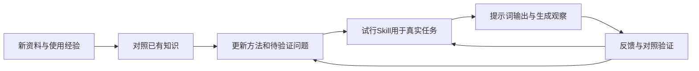

# Seedance 2.5 知识库目录与推进方案

更新：2026-10-25。状态：目录和实施顺序的讨论稿。尚未创建GitHub仓库、迁移资料、安装插件、制作Skill或启动自动化。用户已确定使用GitHub；仓库归属、名称与同步范围待实施时确定。

后续目录与操作流程以[Seedance2.5知识库建设蓝图](Seedance2.5知识库_建设蓝图.md)为当前方案。本文件保留早期方案沿革，不与建设蓝图分别维护两套现行要求。

## 1. 专注的范围

围绕Seedance 2.5提示词建立一个持续积累、可追溯、可用于实际任务的知识库。资料与经验经过整理形成方法，方法进入可试用的Skill，提示词输出和真实生成反馈再推动修订。知识库与试行Skill可以并行推进，不以所有讨论定稿为首版使用前提。

内容覆盖当前已经研究的通用结构、参考分工、人物目的与表演、动作物理、镜头空间、光影色彩、环境声音、连续转场、阶段范围和平台入口。与这些任务无关的AI新闻、办公工具、PPT和生活笔记不纳入本库。

阅读范围：已读[搭建教程](https://ycnezwebj31p.feishu.cn/docx/Tsb6dKRT4oLXhXxg7x5cQ4ADnac)完整正文、三张核心结构与流程图，以及[总目录](https://my.feishu.cn/wiki/RxmAw9xGhiFx0CkptXFcGxFNn8c?from=from_copylink)的完整文字。2026-10-24经飞书CLI取得的正文版本分别为9和2100。目录链接的其他教程、演示视频及附带Skill压缩包未全部展开，不能把这些也标为已读。

教程的原始资料、处理后知识、Skill、产出回流四部分，分别对应下方的资料库、方法知识、技能源码和实践验证。研究记录保留推导过程，帮助理解为什么采用或修改某种方法。

## 2. 拟议目录

以下是目标结构，不表示这些目录已经建立。原有资料库和研究记录先保留原路径、编号及链接，新增部分逐步接入，不先做整库搬迁。

```text
Seedance2.5知识库/
├─ 项目入口.md                         当前导航、进度和使用入口
├─ AGENTS.md                           拟建：知识维护与操作约定
├─ 更新记录.md                         拟建：每轮修改及原因
│
├─ 资料库/                             保留现有原件和编号
│  ├─ 索引.md
│  ├─ 00_完整原始消息/
│  ├─ 01_用户提示词原文/
│  ├─ 02_图片原件/
│  └─ 03_官方参考/
│
├─ 方法知识/                           拟建：当前可查用的方法
│  ├─ 索引.md
│  ├─ 用户约定.md
│  ├─ 通用结构与选用.md
│  ├─ 参考分工与主体一致性.md
│  ├─ 全局设定与本场发展.md
│  ├─ 动作因果与物理反馈.md
│  ├─ 人物表演对白与方言.md
│  ├─ 机位运镜与空间关系.md
│  ├─ 光影色彩材质与环境.md
│  ├─ 声音与跨镜衔接.md
│  ├─ 连续转场与阶段变化.md
│  ├─ 连续性约束与去重复.md
│  └─ Seedance入口与平台差异.md
│
├─ 研究记录/                           保留已有专题推导和案例分析
│  └─ 待验证问题.md                     拟建：少量正在推进的问题
│
├─ 实践与验证/                         拟建：每次实际使用留下记录
│  ├─ 任务索引.md
│  ├─ 固定验证任务/
│  └─ 运行记录/
│     └─ 每次任务/
│        ├─ 任务与版本.md
│        ├─ 提示词.md
│        └─ 结果与反馈.md
│
└─ skills/                             拟建：技能源码
   └─ seedance-prompt/
      ├─ SKILL.md
      ├─ references/                   必要方法引用或发布快照
      └─ scripts/                      确有需要时才增加检查脚本
```

方法知识中的每个文件是一类问题的知识页，不是每次输出都必须出现的栏目。目录也不要求一次填满；先把现有材料能够支持的页面整理出来。`skills/`是拟议源码位置，实际安装、发现与调用按选定运行环境处理，不能仅凭文件存在就宣布可用。

## 3. 现有内容怎样接入

| 现有内容 | 处理方式 |
|---|---|
| 53条文字原文、1张结构原图及官方资料 | 保留原件、编号和出处，按授权决定是否同步远端 |
| 当前通用结构讨论稿 | 保留为研究依据，从中整理当前可采用的总结构与组合方式 |
| 专题研究记录 | 提取方法、适用条件和反例，研究原文继续保留推导与变化历史 |
| R编号规则记录 | 继续用于追溯与索引，链接到方法的主要维护位置 |
| 明确不收录的八份Word | 只使用已获准总结的经验，不复制进来源库、GitHub或测试原文集 |
| 新的提示词和实际反馈 | 按具体任务进入实践记录，再判断是否更新方法或Skill |

同一条方法只设一个主要维护位置。进入方法知识后，索引、总结构和Skill通过引用使用它；研究记录保存为什么得出该结论，不再让三处全文各自改出不同版本。迁移采取逐项提取和链接核对，原有讨论不直接删掉。

## 4. 方法页的最小内容

一页至少能回答：解决什么问题；结论是什么；何时使用和不使用；依据及反例是什么；验证到了哪一层；还关联哪些方法或试验。紧密相关的规则可以放在同页，不把每句话拆成一个文件。

依据性质与验证程度分别记录：

- 用户明确约定按约定执行，例如“强调！”根据任务突出重要对象，不默认锁首帧。
- 官方产品说明注明平台入口、来源版本和核对日期；存在口径差异时保留分歧。
- 案例经验说明观察到的条件和结果；整体出片不错不证明每句提示词都独立有效。
- 研究推导保留待验证状态，可以支持试行，但不包装成模型已保证的能力。

通用导演写法与Seedance特定入口分开维护。以后入口或模型发生变化，应先检查受影响部分，不让某个入口的限制变成整库普遍规则。

## 5. 持续推进的流程



每次处理新增内容，先判断是否允许保存原文、是否已有相同来源、应影响哪些方法，再补充链接、差异和修改原因。一次纠正可能只更新一条规则，不必重新整理整个知识库。

产出回流时保留身份：生成的提示词、AI分析、用户评价和实际视频观察分别记录。派生分析可以提出假设，不能因为被再次收录就成为证明自身的新证据。失败和反例也保留，并限定它们支持或反驳的是哪一部分。

定期维护可检查失效链接、相互冲突、旧版残留、没有依据的结论及长期未解决的问题。初期由真实任务触发即可；需要定时运行时，再单独确定频率与范围，不直接照搬教程中的抓取或复盘计划。

## 6. 第一版Skill可以尽早做什么

首版先做一个任务清楚的Skill：根据已有剧情、分镜、提示词和参考说明，编写或完善Seedance提示词，并检查引用、规则范围、动作接续、表演、声音和重复冲突。

交付主体是可使用的提示词；必要的执行缺口另列简短说明，不把内部检查表粘进正文。不擅自更改既定故事，也不新编情节来凑验证任务。首版职责先到提示词交付，视频生成和剪辑通过后续实践记录连接。

Skill读取当前任务需要的方法，不载入整个资料库。每次试用记录Skill和知识版本；独立分发时只带必要方法快照并标记来源版本，避免人工维护第二套规则。知识维护流程先放在项目约定中，不急着拆成很多维护Skill。

知识的成熟程度与Skill版本分开：候选方法可以进入试行版，反馈决定它需要收窄、修订还是成为当前推荐。不能等所有问题解决才允许试用，也不能因有了v0.1就把全部知识标成已验证。

## 7. 验证分三层

| 层次 | 检查内容 | 结果能说明什么 |
|---|---|---|
| 基础可用性 | 文件、链接、编号、技能发现与调用 | 能按预期进入流程 |
| 提示词行为 | 保留剧情、选对方法、按需强调、局部组织完整、引用和连续性清楚 | 文字输出符合当前要求 |
| 实际生成 | 指定素材与入口下的动作、身份、表演、空间和声音表现 | 为具体条件下的效果提供证据 |

前两层通过不替代出片验证。首批可以直接选已有动作接续、连续转场、对白、参考与方言、物理反馈等少量代表任务；重复版本不算多份独立证据。缺少实际图片或音频时，文字检查可先进行，对应视觉或声音验证标为未执行。

每次运行记录任务、Skill与知识版本、提示词与素材版本、入口和可取得的生成设置、结果位置、具体观察和下一步判断。未公开的模型内部版本不补猜。一次集中验证一个主要改动，复查受影响任务和少量基础任务，保留可回退的原版本，不要求每次重跑全库。

## 8. GitHub与Obsidian的分工

本地Markdown作为共同工作副本，GitHub保存允许同步的文件及版本，Obsidian用于阅读、关联与编辑。三者围绕同一套文件，不另维护一份内容独立的网页Wiki。初期用清楚索引和链接即可，不先引入复杂数据库、全网抓取或大量插件。

建议从私有仓库起步，但具体归属、名称、可见性和同步范围需在实施时确定。允许本地保存不自动等于允许上传；大体积媒体可留在本地或既定素材位置，用版本和路径关联。凭据交给对应CLI管理，不进入知识页、Git历史、提示词或测试材料。

教程中的Horizon、剪藏和导入工具可以在出现明确需求后选择。工具配置服务于知识积累与实践反馈，不作为知识库开始运行的前提。

## 9. 第一轮实施建议

1. 建立入口、维护约定和变更记录，保留原有资料路径。
2. 整理已有核心方法页和少量待验证问题，打通来源与专题链接。
3. 同期制作一个提示词Skill试行版，先跑已有输入上的文字行为检查。
4. 在实际生成任务中补结果与反馈，完成一次方法和Skill的有依据修订。
5. 根据暴露的真实需要，再增加检索、更新获取或定期复盘。

当前只交付这份目录方案。源资料没有搬动，八份Word未入库，GitHub仓库和Skill均未创建。
